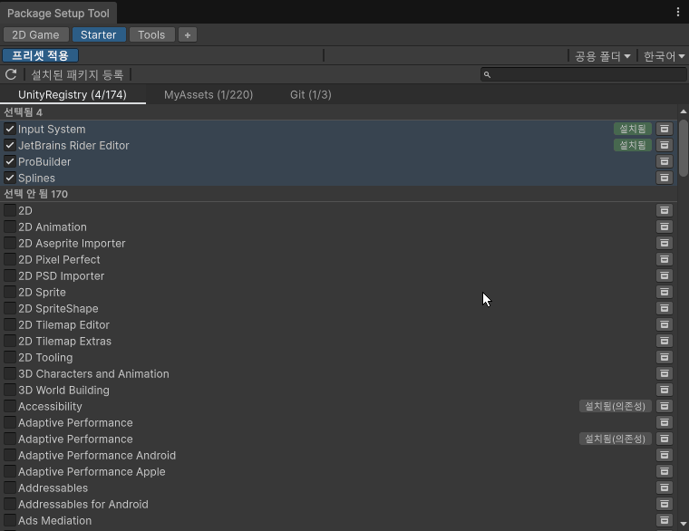
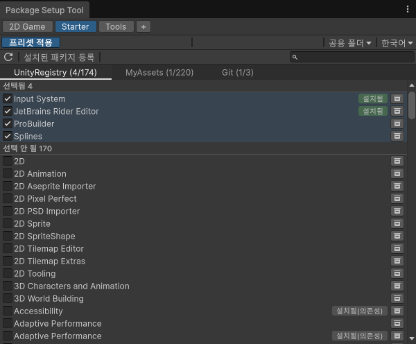
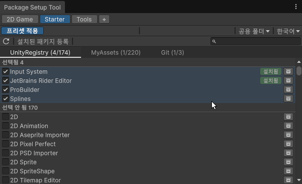
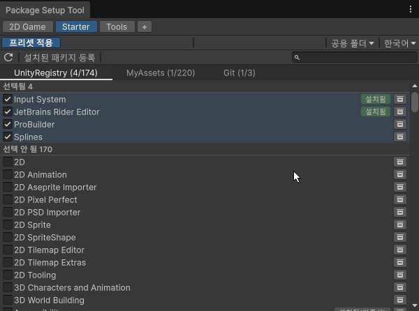
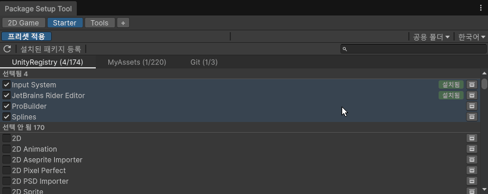

# Package Setup Tool

[English](README.md) | **한국어**

새 Unity 프로젝트를 만들 때마다 같은 패키지를 하나씩 찾아 설치하는 반복 작업을 없애는 도구입니다. 자주 쓰는 패키지를 **프리셋**으로 한 번 정의해 두면, 새 프로젝트에서는 버튼 한 번으로 모두 설치됩니다.

- **Unity Registry**·**Git**(URL)·**Asset Store "My Assets"** 패키지를 한 번에 설치(Asset Store 패키지는 다운로드 후 임포트)
- 적용하기 전에 이미 설치된 항목과 업데이트가 있는 항목을 보여줌
- 패키지를 하나씩 설치하고, 스크립트 재컴파일이나 에디터 재시작 뒤에도 이어서 진행
- 프리셋은 프로젝트 밖에 있어 같은 PC의 모든 프로젝트가 함께 씀
- 셋업이 끝나면 프로젝트에서 도구를 제거



## 목차

- [시작하기](#시작하기)
- [프리셋](#프리셋)
- [패키지 고르기](#패키지-고르기)
- [Git 패키지 URL로 추가](#git-패키지-url로-추가)
- [프리셋 적용](#프리셋-적용)
- [요구 사항](#요구-사항)
- [설치 상세](#설치-상세)
- [라이선스](#라이선스)

## 시작하기

**Window > Package Manager**에서 **+** 버튼의 **Install package from git URL...** 메뉴를 누르고 아래 URL을 입력합니다. 다른 방법은 [설치 상세](#설치-상세)를 보세요.

```
https://github.com/wkdgus26/PackageSetupTool.git
```

**Package Setup > Package Setup Tool**을 엽니다.



1. **모으기**: **목록 갱신** 버튼(↻)이 Unity Registry, Asset Store 구매 목록, 프로젝트에 설치된 Git 패키지를 모읍니다.
2. **고르기**: 프리셋에 패키지를 체크합니다. 행마다 현재 프로젝트에 이미 있는지 표시됩니다.
3. **적용**: 새 프로젝트에서 프리셋을 고르고 **프리셋 적용**을 누릅니다.

UI 언어는 에디터 언어(한국어·영어)를 따르고 툴바에서 바꿀 수 있습니다.

## 프리셋



- **+** 버튼으로 만들고, 더블클릭으로 이름을 바꾸고, 우클릭 메뉴로 이름 변경·복제·삭제합니다.
- 프리셋은 `<내 문서>/PackageSetupTool`에 저장됩니다(`Presets/<이름>.json`, 수집한 패키지 목록은 `Catalog.json`). 툴바의 **공용 폴더**에서 폴더를 바꿀 수 있고, 동기화 폴더로 지정하면 여러 PC가 프리셋을 함께 씁니다.

## 패키지 고르기



- 체크한 패키지는 **선택됨**으로 옮겨지고, 해제하면 돌아갑니다. 검색은 두 구역 모두에 적용됩니다.
- 배지로 현재 프로젝트 상태를 보여줍니다: **설치됨**, **임포트됨**, **설치됨(의존성)**.
- **설치된 패키지 등록**으로 현재 프로젝트에 이미 있는 패키지를 프리셋에 추가합니다.

## Git 패키지 URL로 추가



- 추가하기 전에 URL을 확인합니다(파일 트리만 받음). `?path=`와 `#브랜치`·`#태그`·`#커밋`을 지원합니다.
- 저장소 루트에 `package.json`이 없으면 위치를 찾아 `?path=`를 붙여 줍니다.

## 프리셋 적용

- 설치하기 전에 이미 설치된 항목과 업데이트가 있는 항목을 보여줍니다. 설치된 항목 중 다시 설치할 것을 고릅니다.
- 패키지를 하나씩 설치하므로 하나가 실패해도 나머지는 설치됩니다. 스크립트 재컴파일이나 에디터 재시작 뒤에도 이어서 진행합니다.
- **중단**을 누르면 바로 적용을 끝냅니다. 시작하지 않은 패키지는 건너뛰고 다운로드는 취소하지만, Unity가 이미 시작한 설치·임포트는 끝까지 진행될 수 있습니다.
- 모두 설치되면 진행 화면을 닫을 때 이 프로젝트에서 도구를 제거할지 묻습니다(나중에 **Package Setup > Remove Package Setup Tool**로도 제거할 수 있음).

## 요구 사항

- Unity 6(`6000.0` 이상). 이전 버전 에디터에서는 컴파일되지 않고 비활성으로 남습니다.
- Git 패키지를 쓰려면 [Git](https://git-scm.com/)이 `PATH`에 있어야 합니다.
- Asset Store 기능은 Package Manager 내부 API를 쓰며(6000.3~6000.6에서 확인) 로그인이 필요합니다. 에디터에 해당 API가 없으면 쓸 수 없는 기능을 알려 줍니다.

## 설치 상세

**한 가지 방법으로만 설치하세요.** 두 방법은 같은 에셋 GUID를 씁니다. 도구가 `Assets`에 있는 상태에서 패키지로도 설치하면 Unity가 GUID 충돌을 알리고 `Assets`의 사본을 계속 씁니다. Git URL로 바꾸려면 먼저 `Assets/PackageSetupTool`을 지우세요.

### Git URL

- 버전을 고정하려면 태그나 커밋을 붙입니다: `https://github.com/wkdgus26/PackageSetupTool.git#v1.0.0`.
- `Packages/manifest.json`에 직접 추가해도 됩니다.

  ```json
  {
    "dependencies": {
      "com.jangdol.package-setup-tool": "https://github.com/wkdgus26/PackageSetupTool.git"
    }
  }
  ```

- 업데이트는 Package Manager에서 합니다. 제거는 **Package Setup > Remove Package Setup Tool** 메뉴나 Package Manager에서 합니다.

### .unitypackage

- **Assets > Import Package > Custom Package...** 메뉴로 임포트합니다. 도구는 `Assets/PackageSetupTool`에 들어가며 `Assets` 아래 어느 위치로 옮겨도 됩니다.
- 직접 만들려면 `PackageSetupTool` 폴더를 선택하고 **Assets > Export Package...** 메뉴에서 모든 파일을 포함해 내보냅니다.
- 업데이트는 폴더를 지우고 새 버전을 임포트합니다. 제거는 **Package Setup > Remove Package Setup Tool**(폴더를 휴지통으로 보냄)을 쓰거나 폴더를 지웁니다.

도구를 제거해도 설치한 패키지와 공용 폴더 데이터는 남습니다.

## 라이선스

이 도구는 [MIT 라이선스](LICENSE.md)를 따릅니다.
