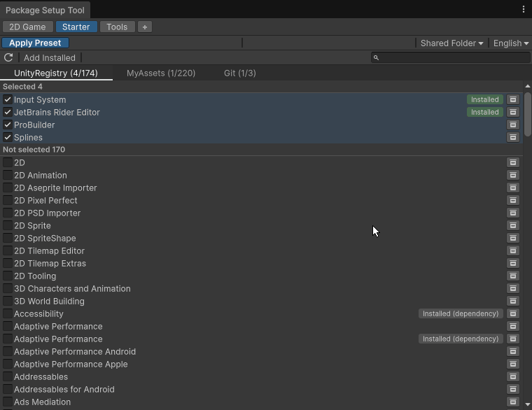
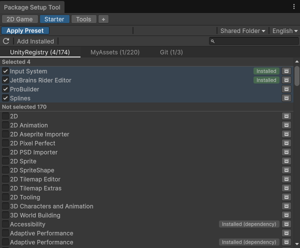
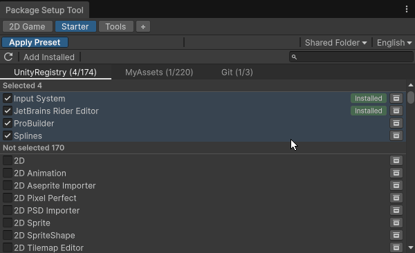
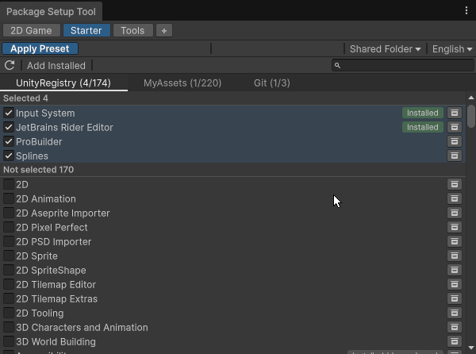
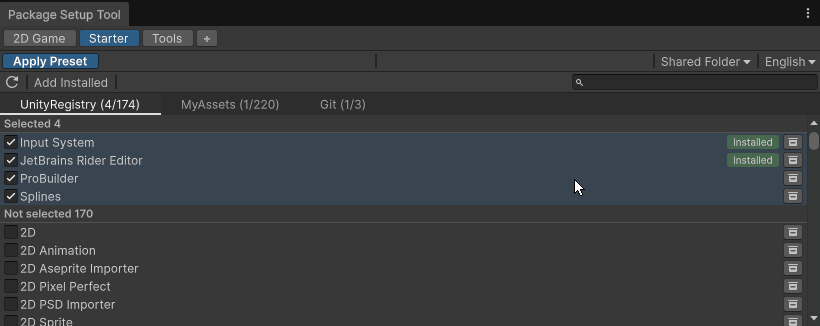

# Package Setup Tool

**English** | [한국어](README.ko.md)

Stop installing the same packages one by one every time you create a Unity project. Define the packages you always use as a **preset** once, and install them all into a new project with one click.

- Installs **Unity Registry**, **Git** (URL) and **Asset Store "My Assets"** packages in one go (Asset Store packages are downloaded and imported)
- Shows what is already installed and which packages have updates before applying
- Installs one package at a time and continues after script recompiles and editor restarts
- Presets live outside the project, so every project on the PC shares them
- Removes itself from the project when setup is done



## Table of Contents

- [Getting started](#getting-started)
- [Presets](#presets)
- [Pick packages](#pick-packages)
- [Add Git packages by URL](#add-git-packages-by-url)
- [Apply a preset](#apply-a-preset)
- [Requirements](#requirements)
- [Installation details](#installation-details)
- [License](#license)

## Getting started

In **Window > Package Manager**, click **+ > Install package from git URL...** and enter the URL below. For other ways, see [Installation details](#installation-details).

```
https://github.com/wkdgus26/PackageSetupTool.git
```

Open **Package Setup > Package Setup Tool**.



1. **Collect**: the **Refresh** button (↻) gathers the Unity Registry, your Asset Store purchases and the Git packages installed in the project.
2. **Pick**: check packages in a preset. Each row shows whether it is already in the current project.
3. **Apply**: in a new project, select the preset and click **Apply Preset**.

The UI follows the editor language (English or Korean) and can be switched on the toolbar.

## Presets



- **+** creates a preset, double-click renames it, right-click opens rename · duplicate · delete.
- Presets are saved in `<Documents>/PackageSetupTool` (`Presets/<name>.json`, and the collected package list in `Catalog.json`). Change the folder with **Shared Folder** on the toolbar; a synced folder shares presets between PCs.

## Pick packages



- Checked packages move to **Selected**, unchecked ones go back. Search filters both sections.
- Badges show the current project: **Installed**, **Imported**, **Installed (dependency)**.
- **Add Installed** adds the packages already in the current project to the preset. Packages that other projects cannot install the same way are left out: packages included with the editor, local packages (embedded, local folder or tarball) and packages installed only as a dependency.

## Add Git packages by URL



- The URL is checked before it is added: only the file list and `package.json` are downloaded, not the whole repository. Supports `?path=` and `#branch`, `#tag` or `#commit`.
- If `package.json` is not at the repository root, the tool finds it and adds `?path=` for you. If it finds several, you pick one from a list. A `?path=` you entered is not changed: if it has no `package.json`, the tool shows the paths it found instead.
- A short commit hash cannot be checked before installing, so the URL is added with a warning. Use the full 40-character hash to have it checked.
- Private repositories need saved credentials (Git Credential Manager or an SSH key), because the tool does not open a sign-in prompt. Without them the URL is added with a warning, and the Package Manager needs the same credentials to install it.

## Apply a preset

- Before installing, the tool shows what is already installed and which packages have updates. You choose which installed ones to reinstall.
- Presets keep packages, not versions. Unity Registry packages get the version the editor recommends, Git packages the `#branch`, `#tag` or `#commit` in the URL (the latest commit of the default branch if none), and Asset Store packages their latest version. Packages already in the project keep their version unless you reinstall them. To always install the same version of a Git package, add a tag or commit to its URL.
- Packages are installed one at a time, so one failure does not block the rest. Applying continues after script recompiles and editor restarts.
- **Stop** ends applying right away. Packages not started are skipped and downloads are cancelled, but an install or import Unity has already started may still finish.
- When everything is installed, closing the progress view offers to remove the tool from the project (**Package Setup > Remove Package Setup Tool** does the same later).

## Requirements

- Unity 6 (`6000.0` or newer). On older editors the tool does not compile and stays inactive.
- Tested on Windows. macOS and Linux have not been tested. On Linux, deleting a preset is not supported (preset files are moved to the trash only on Windows and macOS); delete `Presets/<name>.json` in the shared folder instead.
- [Git](https://git-scm.com/) on `PATH` for Git packages.
- Asset Store features use internal Package Manager APIs (tested on 6000.3–6000.6) and require signing in. If an API is missing in your editor, the tool reports which features are unavailable.

## Installation details

**Install one way only.** Both ways use the same asset GUIDs: if the tool is in `Assets` and also installed as a package, Unity reports GUID conflicts and keeps using the copy in `Assets`. To switch to the Git URL, delete `Assets/PackageSetupTool` first.

### Git URL

- Pin a version with a tag or commit: `https://github.com/wkdgus26/PackageSetupTool.git#v1.0.1`.
- Or add it to `Packages/manifest.json`:

  ```json
  {
    "dependencies": {
      "com.jangdol.package-setup-tool": "https://github.com/wkdgus26/PackageSetupTool.git"
    }
  }
  ```

- Update it from the Package Manager. Remove it with **Package Setup > Remove Package Setup Tool** or the Package Manager.

### .unitypackage

- Import with **Assets > Import Package > Custom Package...**. The tool goes into `Assets/PackageSetupTool` and can be moved to any folder under `Assets`.
- To create one, put this repository in a Unity project as `Assets/PackageSetupTool` (for example `git clone https://github.com/wkdgus26/PackageSetupTool.git Assets/PackageSetupTool`), then select the folder and use **Assets > Export Package...** with all files included.
- To update, delete the folder and import the new version. To remove, use **Package Setup > Remove Package Setup Tool** (moves the folder to the trash) or delete the folder.

Removing the tool keeps the installed packages and the shared folder data.

## License

This tool is under the [MIT License](LICENSE.md).
